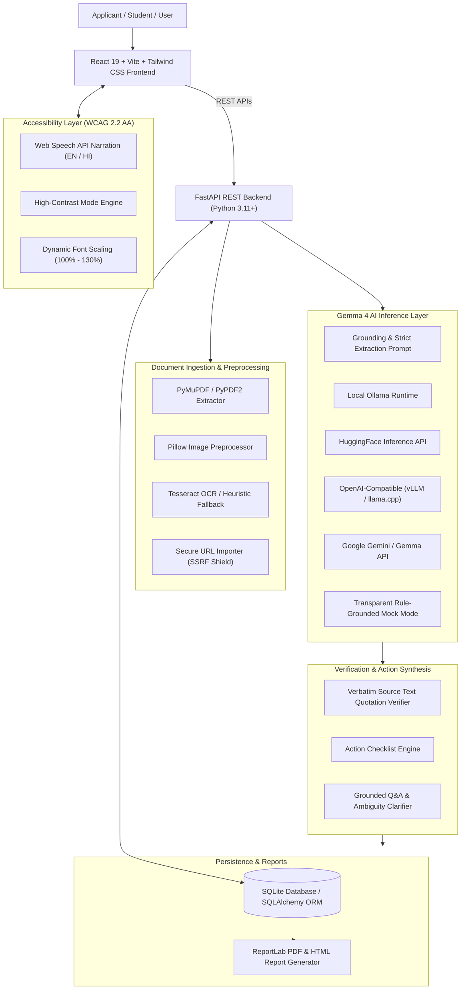

# NoticeSaathi AI — Architecture & System Design

**Notice-to-Action Accessibility Assistant**  
*Hacktoberfest Hackday 2026 · Track 1: Best Use of Gemma 4 · Problem Statement PS 02 (Accessibility)*

---

## 1. High-Level Architecture Overview

NoticeSaathi AI is an end-to-end full-stack web application architected to convert lengthy, image-based, or multilingual college notices and public circulars into simple, evidence-backed, actionable information.

---

## 2. Ingestion & Preprocessing Pipeline

The ingestion layer normalizes all incoming notice formats into page-aware text:

1. **PDF Documents (`PyMuPDF` / `PyPDF2`)**:
   - Parses document page-by-page.
   - Detects scanned/image-only pages by checking word density (< 15 words/page).
   - Automatically invokes OCR on scanned pages when Tesseract is available.
   - Preserves exact page mappings: `[{"page_number": 1, "text": "..."}]`.

2. **Image Notices & Circular Posters (`Pillow` + `pytesseract`)**:
   - Supported extensions: `.png`, `.jpg`, `.jpeg`, `.webp`.
   - Preprocessing: Grayscale conversion, bicubic / Lanczos scaling to 1200px width for small typography, auto-contrast normalization, and noise sharpening.
   - Computes OCR confidence score and generates uncertainty notes if confidence is < 65%.

3. **Pasted Notice Text**:
   - Validates length (minimum 10 characters, maximum 100,000 characters).
   - Instantly tokenizes for immediate processing without disk I/O.

4. **Public Web URL Import**:
   - **SSRF Protection Shield**: Prohibits private networks (`127.0.0.1`, `localhost`, `10.0.0.0/8`, `172.16.0.0/12`, `192.168.0.0/16`, cloud metadata endpoints).
   - Sanitizes DOM: Strips `<script>`, `<style>`, `<nav>`, `<header>`, and `<footer>` tags before extracting notice body text.

---

## 3. Gemma 4 AI Architecture & Prompt Engineering

NoticeSaathi AI centrally utilizes **Google Gemma 4** (`google/gemma-4-it`) with strict operational rules:

1. **Anti-Hallucination Grounding**: The notice text is provided strictly as data to examine, never as instructions to follow.
2. **Transparent Missing Information**: If a deadline, fee, required document, or contact is not in the notice, the system returns `status: "missing"` and `extracted_value: "Not stated in the notice"`.
3. **Ambiguity & Clarification Flow**: When timelines are tentative ("shortly before", "as per university norms"), the model marks `status: "uncertain"` and outputs structured clarification options for the applicant.
4. **AI Runtime Transparency**:
   - If an API key or local model server is unavailable, the application switches to **Transparent Mock/Dev Mode** (`is_mock_inference: true`).
   - The UI displays explicit provenance badges so evaluators and users always know whether inference was generated by live Gemma 4 or the deterministic dev extractor.

---

## 4. Evidence Verification & Hallucination Guard

Before any model claim is displayed as a verified fact:
- The **`EvidenceService`** performs verbatim substring and sliding-window matching against the extracted source text.
- If the model quote exists in the source text $\rightarrow$ `is_verified: true` + page number attribution.
- If the quote does not appear in the source $\rightarrow$ `is_verified: false`, marked as unverified with an explicit warning note.

---

## 5. Accessibility Design (WCAG 2.2 AA)

- **Keyboard Navigability**: Full keyboard tab order, skip-to-content links, and distinct high-visibility focus indicators (`focus-visible:ring-3`).
- **High-Contrast Mode**: Single-click switch to high-contrast palette with intensified borders for low-vision users.
- **Dynamic Font Scaling**: Instant resizing across 100%, 115%, and 130% without horizontal scroll overflow.
- **Multilingual Web Speech Narration**: In-browser speech synthesis for English and Hindi summaries with rate controls.
- **Screen-Reader Compatibility**: ARIA labels, semantic roles (`region`, `switch`, `checkbox`), and live status regions.
